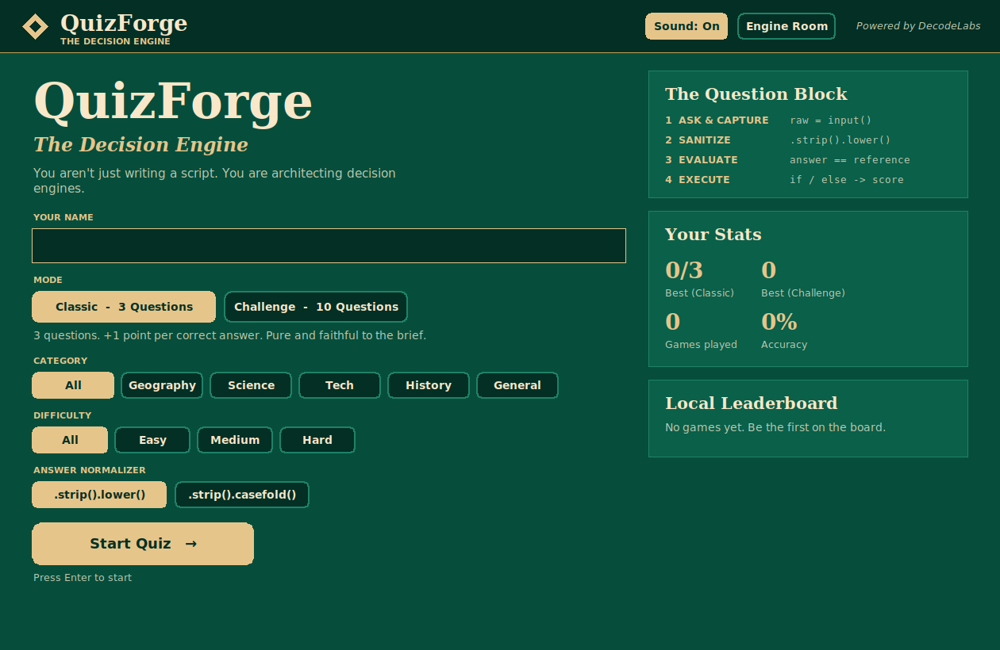
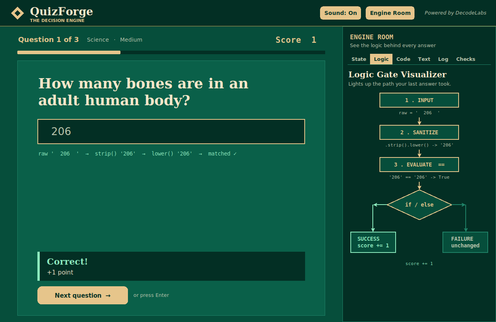
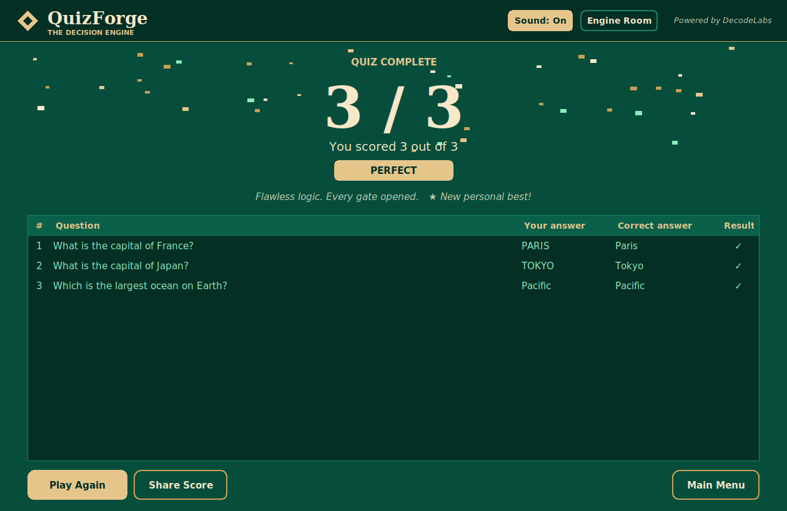

# QuizForge - The Decision Engine

> DecodeLabs Python Programming - **Project 4: The General Knowledge Quiz**
> Pure Python. Zero dependencies. Emerald Ink + Champagne design.

You aren't just writing a script. You are architecting decision engines.





## What it teaches (the brief)

Every question runs the same **Question Block**:

| Step | What happens | Python |
|------|--------------|--------|
| 1. Ask & Capture | read the raw string | `raw = input(...)` |
| 2. Sanitize | filter pipeline | `.strip().lower()` (or `.casefold()`) |
| 3. Evaluate | compare to the reference | `answer == "paris"` |
| 4. Execute | the `if / elif / else` gate | `score += 1` or leave unchanged |

The score is an `int` initialised as `score = 0` (the **Score Vault**).
Architecture follows **IPOS**: Input -> Process -> Output, plus Storage.

## Run it

```bash
python app.py        # the full GUI
python cli.py        # the plain terminal version (exact structure of the brief)
python -m unittest -v   # 27 tests for the logic
```

Needs Python 3.9+ (tkinter ships with the Windows/macOS installers).

## Features

- **Classic mode:** exactly 3 questions, +1 point each, final `Final Score:  2/3`.
- **Challenge mode:** 10 questions, 15 s countdown ring, streak counter, x1 / x2 / x3 bonus multiplier.
- 53 questions, 5 categories, 3 difficulties, typed + multiple choice, aliases (`USA` / `U.S.A` / `United States`).
- Live **Sanitization Inspector**: watch `'  PaRiS  '` -> `strip()` -> `lower()` -> matched.
- Hint, skip, blank-input blocking, Retry Mistakes, Share Score, sound toggle.
- Best scores, last 10 games, accuracy and a local leaderboard saved to JSON (corruption-proof).
- **Engine Room** side panel: Live State Vault, animated Logic Gate flowchart, generated Python code
  (copy button), `lower()` vs `casefold()` matrix, event log, and a verification checklist that runs real tests.
- Keyboard first: `Enter` submit / next, `Esc` skip. The timer pauses when the window loses focus.

## Project structure

```
quiz_engine.py   pure logic: sanitize(), check_answer(), update_score(), GameSession   (MODEL)
questions.py     the question bank (data only)
storage.py       JSON persistence: RAM -> disk
app.py           the tkinter GUI                                                        (VIEW)
engine_room.py   the educational side panel
theme.py         Emerald Ink / Champagne palette + custom rounded widgets
cli.py           the minimal terminal version
test_quiz_engine.py   unit tests
```

The engine never imports tkinter and never calls `input()` / `print()`, so the same rules
power both the GUI and the CLI, and every function is deterministic and testable.

## Design

| Token | Hex |
|-------|-----|
| Emerald Ink (background) | `#064E3B` |
| Champagne (text) | `#F8E7C9` |
| Gold accent | `#E6C58B` |

Built with love for the DecodeLabs internship batch 2026.
